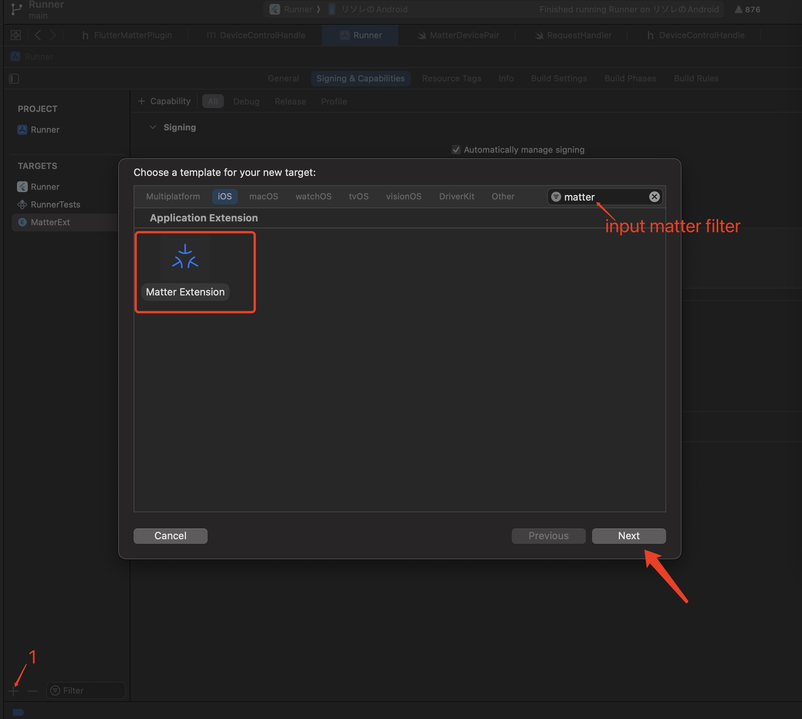
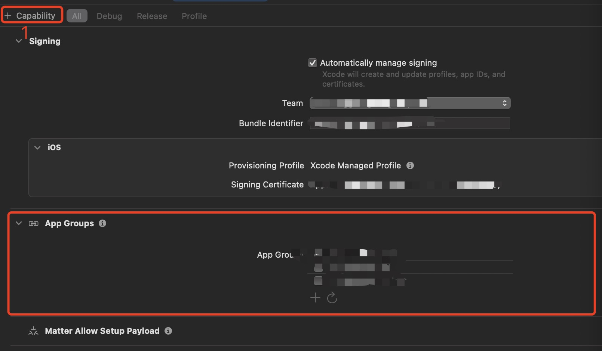
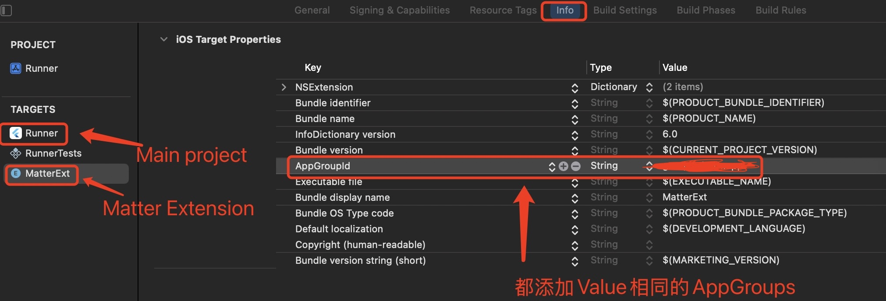

<div align="center">

# flutter_matter

A beautiful and low-level [Matter](https://csa-iot.org/) plugin for **Flutter** on **Android** and **iOS**.

<p align="center">
  
</p>

<p align="center">
  <a href="https://github.com/Tan-yi-xiong/flutter_matter/actions/workflows/dart-gate.yml"></a>
  <a href="https://pub.dev/packages/flutter_matter"></a>
  <a href="LICENSE"></a>
</p>

</div>

---

## 📦 Installation

Add the package:

```sh
flutter pub add flutter_matter
```

Then import it:

```dart
import 'package:flutter_matter/flutter_matter.dart';
```

---

## ✨ Features

- **Provisioning**  
  Supports both **BLE commissioning** and **on-network commissioning**.  
  On Android, you can also provide your own GATT implementation to send Matter commissioning data.

- **Thread network support**  
  Pass a Thread Active Operational Dataset using:

  ```dart
  NetworkCredentials.thread(ThreadCredentials(...))
  ```

- **ICD (Intermittently Connected Devices)**  
  Full support for **Matter 1.2+ ICD commissioning** via:

  ```dart
  CompletionListener.onICDRegistrationComplete
  ```

- **Attribute read**  
  Read any attribute from any cluster.

- **Attribute write**  
  Write any attribute to any cluster.

- **Attribute / event subscribe**  
  Subscribe with optional `DataVersionFilter` for efficient change-only updates.

- **Invoke**  
  Send commands to any cluster endpoint.

- **Unpair**  
  Remove a device from the fabric with:

  ```dart
  unPairDevice(nodeId)
  ```

- **TLV**  
  Full TLV read/write stack for advanced low-level control.

- **Cluster helpers**  
  Convenience wrappers for:
  - `BasicInformationCluster`
  - `DescriptorCluster`

---

## Requirements and platform support

| Area | Supported baseline |
| --- | --- |
| Flutter | Flutter `3.41.0`, pinned in `.fvmrc`; older SDKs satisfy the pubspec constraint but are not currently validated |
| Dart | `>=3.3.3 <4.0.0`, unchanged in `pubspec.yaml` |
| Android | `minSdkVersion 21`, `compileSdk 34`, JDK 17 |
| Example Android build | Gradle 8.7, Android Gradle Plugin 8.6.0, Kotlin 1.7.10 |
| iOS | iOS 16.1 minimum for the plugin and example; Xcode 16.4 or later and CocoaPods 1.17 |
| iOS device support | Physical arm64 iPhoneOS devices only; the vendored `ZGMatter.framework` has no simulator slice |

The Android values describe the current repository build configuration and do not imply that an SDK upgrade has already been completed. The iOS deployment targets are aligned to 16.1. A Flutter 3.41 device build without code signing completed with Xcode 26.3 and CocoaPods 1.17.0.

Automated tests cover the plugin root `test/` suite only. The `example/` application is a build and manual demonstration target, never an automated test target. Device-behavior changes require a versioned Android and/or iOS device-validation report; shared behavior requires both platforms. Formal reports use schema v3 evidence. The device-test app discovers the Matter commissionee concurrently over BLE and Wi-Fi/IP and records the actual selected transport. Device provenance is not part of the report contract.

See [Architecture](ARCHITECTURE.md), [Public API](doc/public-api.md), [Platform support](doc/platform-support.md), [Device validation](doc/device-validation.md), [Device test reports](doc/device-test-report.md), [Contributing](CONTRIBUTING.md), [Security policy](SECURITY.md), [Release process](doc/releasing.md), [Third-party notices](THIRD_PARTY_NOTICES.md), and the [PR review checklist](doc/pr-review-checklist.md) for details.

---

## 🚀 Getting Started

## Android

Make sure the following permissions are added to your **AndroidManifest.xml**:

```xml
<!-- Tell Google Play Store that your app uses Bluetooth LE -->
<!-- Set android:required="true" if Bluetooth is required -->
<uses-feature
    android:name="android.hardware.bluetooth_le"
    android:required="false" />

<!-- Android 12+ Bluetooth permissions -->
<uses-permission
    android:name="android.permission.BLUETOOTH_SCAN"
    android:usesPermissionFlags="neverForLocation" />
<uses-permission android:name="android.permission.BLUETOOTH_CONNECT" />

<!-- Android 11 and lower -->
<uses-permission
    android:name="android.permission.BLUETOOTH"
    android:maxSdkVersion="30" />
<uses-permission
    android:name="android.permission.BLUETOOTH_ADMIN"
    android:maxSdkVersion="30" />
<uses-permission
    android:name="android.permission.ACCESS_FINE_LOCATION"
    android:maxSdkVersion="30" />

<!-- Android 9 and lower -->
<uses-permission
    android:name="android.permission.ACCESS_COARSE_LOCATION"
    android:maxSdkVersion="28" />

<uses-permission android:name="android.permission.ACCESS_WIFI_STATE" />
<uses-permission android:name="android.permission.CHANGE_WIFI_STATE" />
<uses-permission android:name="android.permission.WRITE_EXTERNAL_STORAGE" />
```

---

## iOS

### 1. Add the required keys to `Info.plist`

```xml
<key>NSBluetoothAlwaysUsageDescription</key>
<string>This app uses Bluetooth to connect to nearby devices for communication.</string>

<key>NSBonjourServices</key>
<array>
  <string>_meshcop._udp</string>
  <string>_matter._tcp</string>
  <string>_matterc._udp</string>
  <string>_matterd._udp</string>
</array>

<key>NSCameraUsageDescription</key>
<string>This app needs camera access to scan QR codes.</string>

<key>NSLocalNetworkUsageDescription</key>
<string>Required to discover local network devices.</string>
```

### 2. Add a Matter Extension to your project

<p align="center">
  
</p>

### 3. Add capabilities to both targets

In both the **main app target** and the **Matter Extension target**, add:

- **App Groups**
- **Matter Allow Setup Payload**

Make sure both targets use the **same App Group**.

<p align="center">
  
</p>

### 4. Add `AppGroupId` to both targets

In the **Info** section of both the main app target and the Matter Extension target, add:

- **Key:** `AppGroupId`
- **Value:** the same App Group value selected in step 3

This allows data sharing between the two targets.

<p align="center">
  
</p>

### 5. Copy the request handler code

Copy the contents of:

```text
example/ios/MatterExt/RequestHandler.swift
```

into your Matter Extension’s:

```text
RequestHandler.swift
```

---

## ▶️ Run the Example

## iOS

Open the following workspace in Xcode:

```sh
example/ios/Runner.xcworkspace
```

Then:

1. Fill in your signing information
2. Complete the iOS setup steps above

## Android

No additional setup is required.

## Start the example

```sh
cd example
fvm flutter pub get
fvm flutter run
```


---

## Device test app

The dedicated validation app lives in `device_test_app/`. It supports Android and physical iOS controllers and requires a Matter commissionee for formal evidence. Every device run uses concurrent BLE and Wi-Fi/IP discovery and the first matching transport, without fallback after a commissioning failure. It can run a quick five-test commissioning/control profile during development or the full 12-test validation matrix for formal evidence. The app does not inspect or record device provenance.

```bash
cd device_test_app
fvm flutter pub get
fvm flutter test
fvm flutter run
```

Agent-driven runs use the Mac WebSocket bridge and the repository Skill `flutter-matter-device-test`. When more than one phone is connected, the Agent must ask the user which phone to use. See [Device test app](doc/device-test-app.md) and [Agent device testing](doc/agent-device-testing.md).

---

## 📌 Notes

- Images are displayed using fixed widths to keep them clean and prevent stretching.
- Centered screenshots and demo media usually make plugin documentation look much better.
- This README keeps the setup simple while still looking polished and professional.

---

## 🔐 Security

Report suspected vulnerabilities privately through [GitHub Private Vulnerability Reporting](https://github.com/Tan-yi-xiong/flutter_matter/security/advisories/new). Do not open a public issue for a suspected vulnerability. See [SECURITY.md](SECURITY.md) for scope, required report details, and disclosure expectations.

## 📄 License

Original `flutter_matter` code is licensed under the [MIT License](LICENSE). Project CHIP/Matter SDK-derived source and bundled Matter binaries retain their Apache-2.0 terms; see [THIRD_PARTY_NOTICES.md](THIRD_PARTY_NOTICES.md).

---

## 🤝 Contributing

Contributions, issues, and feature requests are welcome.

If you find this plugin useful, consider giving it a star.
