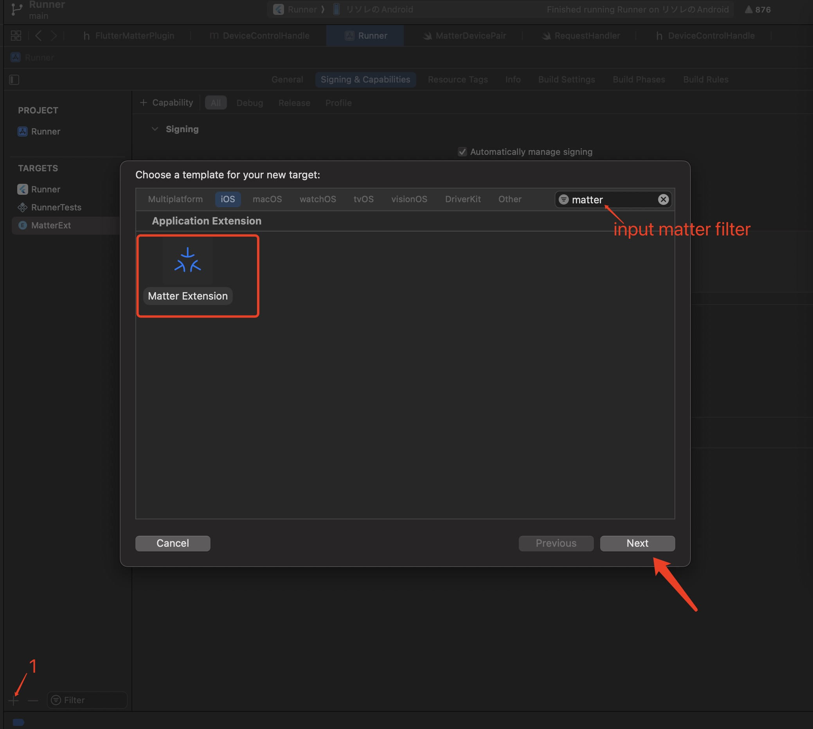
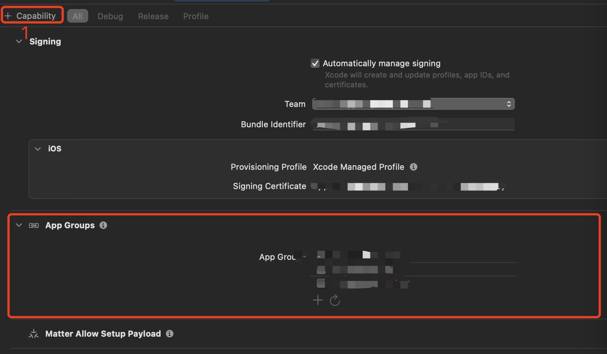
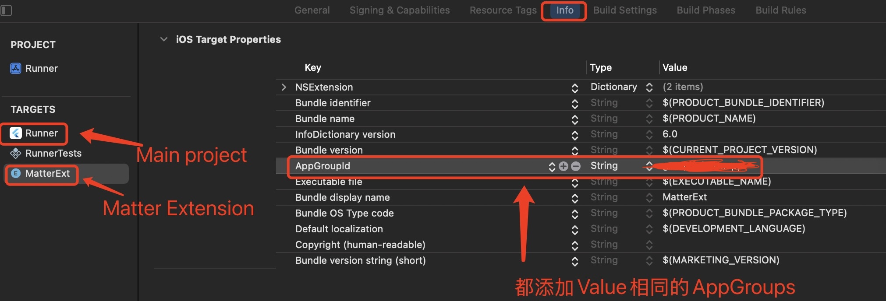

# Getting started

This guide takes a Flutter host app from installation to its first commissioned Matter device. The plugin controls and commissions devices; the host app still owns permissions, secure credential storage, and UI.

## Prerequisites

- Flutter 3.41.0, the validated baseline. See [Platform support](platform-support.md) for the complete matrix.
- A Matter commissionee with an open commissioning window.
- A physical Android device or iPhone. The vendored `ZGMatter.framework` has no iOS simulator slice.
- Network credentials for the commissionee, or its setup payload for an SDK-managed flow.

## 1. Add the package

```sh
flutter pub add flutter_matter
```

```dart
import 'package:flutter_matter/flutter_matter.dart';
```

## 2. Configure Android

### Add the JitPack repository

The Android controller stack is hosted on JitPack (`com.github.Tan-yi-xiong:flutter_matter_android_prefixed`). Gradle resolves dependencies using the repositories of the consuming `:app` module, so the plugin cannot declare this repository for you.

In the stock Flutter template, add JitPack to the root-level `allprojects` block in `android/build.gradle`:

```groovy
allprojects {
    repositories {
        google()
        mavenCentral()
        maven { url 'https://jitpack.io' }
    }
}
```

This is what the bundled `example/` does.

Add the permissions your feature set needs to the host app's `android/app/src/main/AndroidManifest.xml`:

```xml
<uses-feature
    android:name="android.hardware.bluetooth_le"
    android:required="false" />

<uses-permission
    android:name="android.permission.BLUETOOTH_SCAN"
    android:usesPermissionFlags="neverForLocation" />
<uses-permission android:name="android.permission.BLUETOOTH_CONNECT" />

<uses-permission
    android:name="android.permission.BLUETOOTH"
    android:maxSdkVersion="30" />
<uses-permission
    android:name="android.permission.BLUETOOTH_ADMIN"
    android:maxSdkVersion="30" />
<uses-permission
    android:name="android.permission.ACCESS_FINE_LOCATION"
    android:maxSdkVersion="30" />
<uses-permission
    android:name="android.permission.ACCESS_COARSE_LOCATION"
    android:maxSdkVersion="28" />

<uses-permission android:name="android.permission.ACCESS_WIFI_STATE" />
<uses-permission android:name="android.permission.CHANGE_WIFI_STATE" />
<uses-permission android:name="android.permission.CHANGE_WIFI_MULTICAST_STATE" />
<uses-permission android:name="android.permission.INTERNET" />

<!-- Optional: QR scanning. -->
<uses-permission android:name="android.permission.CAMERA" />
```

Declaring permissions does not grant them. Request Android 12+ Bluetooth permissions, legacy location access where required, and camera access before using those features.

The plugin supports `minSdk 21` and `compileSdk 34`. The example uses newer Android values because of its Google Home integration; keep the two baselines separate.

## 3. Configure iOS

iOS requires a Matter Extension and shared App Group configuration. Use the same deployment target and App Group in both targets.

### Add Info.plist keys

Add these keys to the main app's `Info.plist`:

```xml
<key>NSBluetoothAlwaysUsageDescription</key>
<string>Connect to nearby Matter devices.</string>

<key>NSBonjourServices</key>
<array>
  <string>_meshcop._udp</string>
  <string>_matter._tcp</string>
  <string>_matterc._udp</string>
  <string>_matterd._udp</string>
</array>

<key>NSLocalNetworkUsageDescription</key>
<string>Discover Matter devices on the local network.</string>

<key>NSCameraUsageDescription</key>
<string>Scan Matter setup QR codes.</string>
```

The camera key is only needed if the app scans setup QR codes.

### Add a Matter Extension

In Xcode, add a Matter Extension target to the Runner project.

<p align="center">
  
</p>

### Share an App Group

Add **App Groups** and **Matter Allow Setup Payload** to both the Runner and Matter Extension targets. Both targets must use the same App Group.

<p align="center">
  
</p>

### Set AppGroupId

Add `AppGroupId` to the Info settings of both targets. Its value must match the App Group selected above.

<p align="center">
  
</p>

### Add the request handler

Copy `example/ios/MatterExt/RequestHandler.swift` into the extension target's `RequestHandler.swift` and keep the class name expected by the example.

## 4. Create a persistent controller identity

Create the controller from a persistent fabric identity. `newControllerIfNotExist` reuses an existing controller when `fabricId` and `rootCertificate` match.

```dart
final identity = await identityRepository.loadOrCreate();
final controller = await ChipDeviceController.newControllerIfNotExist(
  identity.controllerParams,
);
```

The example's `MatterIdentity` builds `ControllerParams` from a keypair, root certificate, operational certificate, and fabric ID. See [`MatterIdentity`](../example/lib/src/identity.dart#L13-L41) and [`MatterIdentityRepository.loadOrCreate`](../example/lib/src/identity.dart#L48-L67).

Keep the private key, certificates, setup payloads, and Wi-Fi credentials in platform secure storage. The example uses `SharedPreferences` only because it is a demo.

> [!WARNING]
> `ControllerParams` currently sends `skipAttestationCertificateValidation: true`. Treat this as a security-sensitive native-configuration limit and review it before production use. See [Public API](public-api.md#controller-and-commissioning).

## 5. Commission a device

The SDK-managed path uses `pairDevice`. The call starts native discovery and pairing; wait for `CompletionListener.onCommissioningComplete` before treating the node as commissioned.

```dart
await controller.setNocChainIssuer(nocChainIssuer);

await controller.pairDevice(
  nodeId,
  null,
  setupPinCode,
  onboardingPayload,
  null,
  NetworkCredentials.wifi(
    WiFiCredentials(ssid: ssid, password: password),
  ),
  attestationDelegate: attestationDelegate,
  completionListener: completionListener,
);
```

The complete implementation, including callback completion, timeout, cancellation, and NOC issuance, is in [`MatterCommissioningService.commission`](../example/lib/src/commissioning_service.dart#L26-L93) and [`_CommissioningDelegate`](../example/lib/src/commissioning_service.dart#L208-L320).

Important behavior:

- `pairDevice` requires a setup PIN or onboarding payload on Android.
- iOS requires an onboarding payload.
- An empty Wi-Fi password represents an open network.
- Use `NetworkCredentials.thread(ThreadCredentials(...))` for a Thread operational dataset.
- Direct-address commissioning uses `pairDeviceWithAddress` and is Android-only.

## 6. Connect and read

After commissioning, establish a CASE connection with `connectedDevice`, pass the returned connection context to `read`, `write`, `invoke`, or `subscribe`, and release it with `releaseConnectContext`.

The complete flow, including callback-to-`Future` adapters and subscription cleanup, is in [`MatterApiService`](../example/lib/src/matter_api_service.dart#L8-L220). Continue with [Device operations](device-operations.md).

## Try the example app

The example is the runnable reference for the full UI and API flows. Its README contains the platform-specific build requirements and a source map:

- [Example app](../example/README.md)
- [Commissioning service](../example/lib/src/commissioning_service.dart#L12-L320)
- [Device operations service](../example/lib/src/matter_api_service.dart#L8-L320)

## Next steps

- [Commissioning guide](commissioning.md)
- [Device operations](device-operations.md)
- [Public API](public-api.md)
- [Platform support](platform-support.md)
